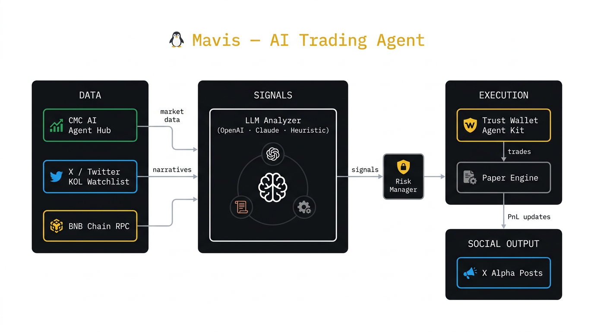

# 🐧 Mavis — BNB Hack: AI Trading Agent

> AI trading agent for the **BNB Hack: AI Trading Agent Edition** hackathon
> (BNB Chain × CoinMarketCap × Trust Wallet — $36K prize pool, 3 weeks).



Mavis is an autonomous crypto agent that **reads markets, reads narratives, and
acts on them** — covering both tracks of the hackathon in a single integrated
system.

## ✨ What it does

**Track 1 — Onchain Trading Agent** (`agent.execution.trust_wallet`)
- Pulls live market data from the **CMC AI Agent Hub** (CEX, derivatives,
  on-chain, social, KOLs, news)
- Generates trading signals with an LLM strategy (`agent.signals.llm_analyzer`)
- Executes on **BNB Chain testnet** via the **Trust Wallet Agent Kit**
- Paper-trades locally with real prices for safe backtesting
- Risk-managed: position sizing, stop-loss, max drawdown, daily trade cap

**Track 2 — Narrative/Social Agent** (`agent.social.poster`)
- Streams **X/Twitter** mentions from a curated KOL/influencer watchlist
- Correlates narrative spikes (mention volume × sentiment × price action)
- Posts alpha alerts back to X with the agent's reasoning chain
- Maintains a "narrative heatmap" viewable on the dashboard

**Bonus — Trust Wallet Agent Kit integration** (`agent.execution.trust_wallet`)
- Real on-chain transaction signing (testnet) for verified wallet actions
- Reads wallet balances, token approvals, and recent history

## 🏗️ Architecture

```
              ┌────────────────────┐
              │   ORCHESTRATOR     │
              │ (agent/main.py)    │
              └─────────┬──────────┘
                        │
   ┌────────────────────┼────────────────────┐
   │                    │                    │
   ▼                    ▼                    ▼
┌──────────┐      ┌──────────┐         ┌──────────┐
│   DATA   │      │ SIGNALS  │         │ EXECUTION│
│          │      │          │         │          │
│ CMC API  │      │ LLM      │         │ Trust    │
│ X feed   │─────▶│ Analyzer │────────▶│ Wallet   │
│ BNB RPC  │      │ Strategy │         │ Paper    │
└──────────┘      └──────────┘         └────┬─────┘
                                            │
                                            ▼
                                     ┌──────────┐
                                     │  SOCIAL  │
                                     │          │
                                     │ X poster │
                                     │ Dashboard│
                                     └──────────┘
```

## 🚀 Quick start

```bash
# 1. Install
git clone https://github.com/al-michiboo/bnbhack-trading-agent.git
cd bnbhack-trading-agent
pip install -e .

# 2. Configure
cp .env.example .env
# Fill in: CMC_API_KEY, OPENAI_API_KEY, X_BEARER_TOKEN, BNB_RPC_URL, TW_PRIVATE_KEY

# 3. Run the dashboard
uvicorn api.server:app --reload --port 8080

# 4. Run the agent in another shell
python -m agent.main

# 5. Run the demo (one shot, no real trades)
python scripts/run_demo.py
```

## 🧪 Tests

```bash
pytest tests/ -v
```

## 📊 What you'll see

The dashboard (`http://localhost:8080`) shows:
- **Live PnL** across paper + on-chain wallets
- **Active signals** with the LLM's reasoning
- **Narrative heatmap** — which coins are getting talked about most
- **Recent trades** with timestamps and tx hashes
- **Risk metrics** — drawdown, exposure, leverage

## 🏆 Hackathon fit

| Track | Coverage | How |
|---|---|---|
| **Onchain Trading Agent** | ✅ | `agent/execution/trust_wallet.py` + real BNB testnet tx |
| **Narrative/Social Agent** | ✅ | `agent/social/poster.py` + X stream + KOL watchlist |
| **CMC AI Agent Hub usage** | ✅ | `agent/data/cmc_client.py` uses 6+ CMC endpoints |
| **Trust Wallet Agent Kit** | ✅ | `agent/execution/trust_wallet.py` |
| **BNB Chain deployment** | ✅ | Targets BNB Smart Chain testnet (chain id 97) |

## 🔐 Security

- Private keys never leave the agent process
- Default mode is **paper trade** — no real funds at risk
- Testnet by default; mainnet requires explicit `BNB_NETWORK=mainnet`
- `.env` is git-ignored; no secrets in code

## 📜 License

MIT
